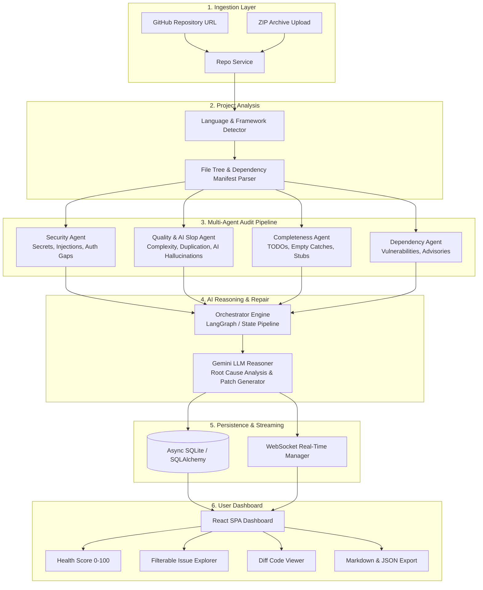

# 🛡️ CodeSentinel – AI-Powered Autonomous Codebase Auditor

[](https://www.python.org/)
[](https://fastapi.tiangolo.com/)
[](https://react.dev/)
[](https://tailwindcss.com/)
[]()
[]()

> **An intelligent, architecture-agnostic autonomous agent team that scans any software repository, detects security vulnerabilities, flags AI-generated slop, identifies implementation gaps, audits dependencies, and produces actionable code patches.**

---

## 🌟 Why CodeSentinel?

Traditional static analysis tools (linters, simple regexes) only flag rigid syntax patterns without context. When developers push code to production—especially with the rise of AI code generation—codebases accumulate:
1. **Hidden Security Flaws**: Leaked API keys, SQL injections, insecure deserialization, and dangerous configurations.
2. **AI Slop**: Meaningless wrapper functions, redundant comments, hallucinated imports, and bloated dead code.
3. **Coding Gaps & Loose Ends**: Forgotten `TODO` comments, empty `except: pass` catch blocks, missing validations, and incomplete stubs.
4. **Vulnerable Dependencies**: Packages with known vulnerabilities and outdated versions.

**CodeSentinel** acts as an autonomous senior software auditor. It automatically detects project languages and frameworks, deploys specialized agents, correlates findings, and leverages Google Gemini to provide **context-aware explanations and drop-in code fixes**.

---

## 🏛️ System Architecture



---

## 🤖 The 4 Specialized Agents

| Agent | Focus Area | What It Detects | Actionable Output |
|---|---|---|---|
| **🔒 Security Agent** | Critical Vulnerabilities | API keys, database credentials, SQL injections, SSRF, weak hashing, CORS wildcards | Safe parameterized queries, env-variable refactorings |
| **📐 Quality & Slop Agent** | AI Slop & Maintainability | Meaningless wrappers, redundant comments, duplicate functions, cyclomatic complexity > 10 | Clean idiomatic refactored code |
| **🧩 Completeness Agent** | Loose Ends & Gaps | `TODO`/`FIXME` items, empty `except`/`catch` blocks, missing validations, stub functions | Robust error handlers, input validator logic |
| **📦 Dependency Agent** | Supply Chain Security | Outdated packages, known CVEs in `requirements.txt`, `package.json`, `pom.xml`, `go.mod` | Safe upgrade targets and patch versions |

---

## ✨ Standout Features

### 1. 🌐 Architecture-Agnostic Scanning
CodeSentinel automatically identifies languages and frameworks without manual configuration. It works across:
- **Python** (FastAPI, Django, Flask)
- **JavaScript / TypeScript** (React, Next.js, Vue, Node.js, Express)
- **Java** (Spring Boot, Maven, Gradle)
- **Go, Rust, PHP, Ruby**, and polyglot monorepos.

### 2. 🧠 Context-Aware Detection (Not Just Static Flags)
Instead of a generic *"Missing exception handling"*, CodeSentinel explains:
> *"This database query can throw an `OperationalError` if the connection pool is exhausted. Currently, the empty `except:` block silently swallows failures, causing API callers to receive malformed responses with no audit trail."*

### 3. 🛠️ Actionable Drop-In Fixes
Every finding includes:
- **Severity Rating**: Critical, High, Medium, Low, Info
- **File & Line Numbers**: Exact coordinates in the file tree
- **Contextual Code Snippet**
- **Original vs. Suggested Corrected Code**: Ready to review and apply

### 4. ⚡ Real-Time Scanning & Interactive Dashboard
- Live progress updates streamed via **WebSockets** (with automatic HTTP polling fallback).
- Interactive **Health Score** (0–100) reflecting repository risk.
- Search and filter issues by agent category or severity.
- **One-click Export** to formatted Markdown and machine-readable JSON.

### 5. 🛡️ Graceful Degradation
- If a Google Gemini API key is provided, CodeSentinel performs deep contextual reasoning and AI patch generation.
- If run offline or without an API key, CodeSentinel's high-performance static AST/regex pattern engines deliver full audit findings without failing.

---

## 🚀 Quick Start

### Option A: One-Command Start (Recommended)

```bash
# Clone the repository
git clone https://github.com/your-username/codesentinel.git
cd codesentinel

# Run the automated launch script
./start.sh
```
Open **[http://localhost:8000](http://localhost:8000)** in your browser!

---

### Option B: Manual Setup

#### 1. Backend Setup
```bash
# Create and activate virtual environment
python3 -m venv backend/venv
source backend/venv/bin/activate

# Install dependencies
pip install -r requirements.txt

# (Optional) Set your Gemini API key for AI-enhanced explanations
export GEMINI_API_KEY="your-gemini-api-key"

# Start the FastAPI server
export PYTHONPATH=backend
python3 -m uvicorn app.main:app --host 0.0.0.0 --port 8000 --reload
```

#### 2. Frontend Setup (Dev Mode)
```bash
cd frontend
npm install
npm run dev
```
Open **[http://localhost:5173](http://localhost:5173)** to access the Vite development server.

---

## 📡 API Reference

| Method | Endpoint | Description |
|---|---|---|
| `GET` | `/api/health` | Health check and system status |
| `POST` | `/api/scans` | Initiate scan from a GitHub repository URL |
| `POST` | `/api/scans/upload` | Initiate scan from an uploaded ZIP archive |
| `GET` | `/api/scans` | List all historical scans (paginated) |
| `GET` | `/api/scans/{id}` | Get scan summary, metadata, and all detected issues |
| `GET` | `/api/scans/{id}/progress` | Polling endpoint for live scan progress |
| `GET` | `/api/scans/{id}/report?format=markdown\|json` | Download complete audit report |
| `DELETE` | `/api/scans/{id}` | Delete scan and clean up cloned workspace |
| `WS` | `/api/ws/scan/{id}` | WebSocket stream for real-time progress events |

Interactive Swagger documentation is available at **[http://localhost:8000/docs](http://localhost:8000/docs)**.

---

## 🧪 Testing

CodeSentinel includes a comprehensive test suite covering file processing, language detection, agent static analyzers, pipeline orchestration, and REST/WebSocket endpoints.

```bash
# Run all unit and integration tests
PYTHONPATH=backend backend/venv/bin/pytest backend/tests -v
```

**Results:**
```text
backend/tests/test_agents.py::test_security_agent_detects_secrets_and_sqli PASSED
backend/tests/test_agents.py::test_quality_agent_detects_complexity_and_ai_slop PASSED
backend/tests/test_agents.py::test_completeness_agent_detects_todos_and_empty_handlers PASSED
backend/tests/test_agents.py::test_dependency_agent_detects_vulnerable_packages PASSED
backend/tests/test_api_endpoints.py::test_health_endpoint PASSED
backend/tests/test_api_endpoints.py::test_scans_list_endpoint PASSED
backend/tests/test_api_endpoints.py::test_zip_upload_and_scan_flow PASSED
backend/tests/test_audit_pipeline.py::test_full_audit_pipeline_on_sample_repo PASSED
backend/tests/test_file_utils.py::test_get_source_files PASSED
backend/tests/test_file_utils.py::test_find_dependency_files PASSED
backend/tests/test_language_detector.py::test_detect_languages PASSED
backend/tests/test_language_detector.py::test_detect_frameworks_fastapi_and_react PASSED

======================== 12 passed in 0.58s ========================
```

---

## 📁 Repository Structure

```text
mycrobo/
├── README.md                      # Comprehensive project documentation
├── requirements.txt               # Backend Python dependencies
├── start.sh                       # One-click startup script
├── .gitignore                     # Git ignore rules
├── .env.example                   # Environment configuration template
│
├── backend/                       # FastAPI Backend
│   ├── app/
│   │   ├── main.py                # FastAPI entry point & SPA static host
│   │   ├── config.py              # Application settings (Pydantic)
│   │   ├── api/
│   │   │   ├── routes.py          # REST API endpoints & background scan runner
│   │   │   └── websocket.py       # WebSocket connection manager
│   │   ├── agents/
│   │   │   ├── base_agent.py      # Abstract base agent interface
│   │   │   ├── security_agent.py  # Security vulnerability detection
│   │   │   ├── quality_agent.py   # AI slop & code quality analysis
│   │   │   ├── completeness_agent.py # TODOs, empty catch blocks, stubs
│   │   │   ├── dependency_agent.py# Package manifest & vulnerability audit
│   │   │   └── orchestrator.py    # LangGraph multi-agent pipeline
│   │   ├── models/
│   │   │   ├── database.py        # Async SQLite database engine
│   │   │   ├── orm_models.py      # SQLAlchemy models (Scan, Issue)
│   │   │   └── schemas.py         # Pydantic request/response schemas
│   │   ├── services/
│   │   │   ├── repo_service.py    # Git cloning, ZIP extraction, cleanup
│   │   │   ├── analyzer.py        # Project structure & file tree analysis
│   │   │   └── report_generator.py# Markdown and JSON report generator
│   │   └── utils/
│   │       ├── file_utils.py      # Safe file reading and filtering
│   │       ├── language_detector.py# Polyglot language & framework detection
│   │       └── llm_client.py      # Google Gemini API client & fallbacks
│   └── tests/                     # Test suite
│       ├── test_agents.py
│       ├── test_api_endpoints.py
│       ├── test_audit_pipeline.py
│       ├── test_file_utils.py
│       └── test_language_detector.py
│
├── frontend/                      # React SPA Dashboard
│   ├── src/
│   │   ├── App.jsx                # Router & base layout
│   │   ├── main.jsx               # Entry point
│   │   ├── index.css              # Custom styling & dark-theme utilities
│   │   ├── pages/
│   │   │   ├── Home.jsx           # Landing hero, scan submit, recent audits
│   │   │   ├── Scan.jsx           # Live WebSocket scanning progress view
│   │   │   └── Report.jsx         # Full report, health score, filters, export
│   │   ├── components/
│   │   │   ├── Navbar.jsx         # Brand header & links
│   │   │   ├── ScanForm.jsx       # GitHub URL / ZIP upload tabs
│   │   │   ├── ScanProgress.jsx   # Animated step progress bar
│   │   │   ├── StatCards.jsx      # Health score, metrics, distributions
│   │   │   ├── IssueCard.jsx      # Expandable card with code diffs & fixes
│   │   │   └── SeverityBadge.jsx  # Severity pill badges
│   │   └── services/
│   │       └── api.js             # API & WebSocket client
│   ├── package.json
│   ├── tailwind.config.js
│   └── vite.config.js
│
└── tests/
    └── sample_repos/              # Sample test repositories
        └── vulnerable_app/        # Test app with deliberate vulnerabilities
```

---

## 🏆 Hackathon Evaluation Criteria Alignment

| Requirement | How CodeSentinel Meets It |
|---|---|
| **Architecture-Agnostic** | Automatically identifies programming languages and frameworks across Python, JS/TS, Java, Go, Rust, PHP, Ruby, etc. |
| **Security Detection** | Flags secrets, SQL injections, SSRF, insecure deserialization, and dangerous configs. |
| **AI Slop Detection** | Detects redundant wrapper functions, duplicate logic, meaningless comments, and excessive nesting. |
| **Coding Gaps & Loose Ends** | Uncovers unhandled exceptions, empty catch blocks, TODO comments, and missing input validation. |
| **Dependency Auditing** | Scans dependency manifests against known vulnerable packages and CVE databases. |
| **Actionable Fixes** | Explains *why* the issue matters, provides recommended remediations, and shows drop-in corrected code. |
| **Interactive UI & Exports** | Modern React dashboard with live WebSocket scan progress, filterable issues, and Markdown/JSON report downloads. |

---

## 📄 License

MIT License — Feel free to use and extend for your software auditing workflows.
